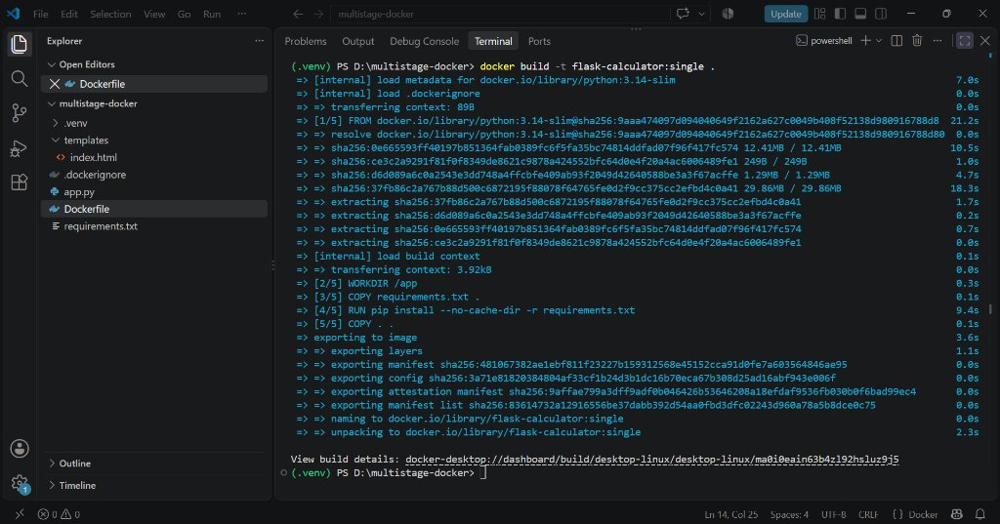
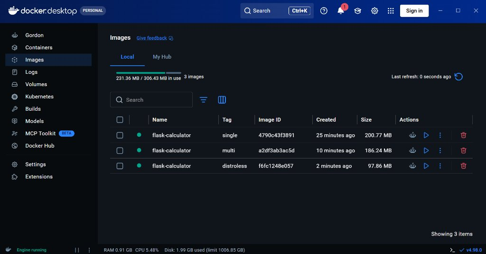
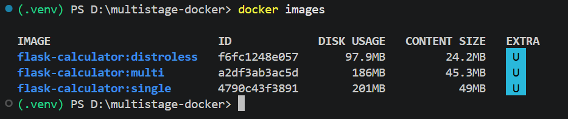
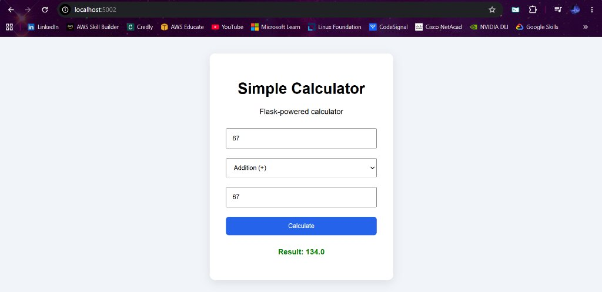
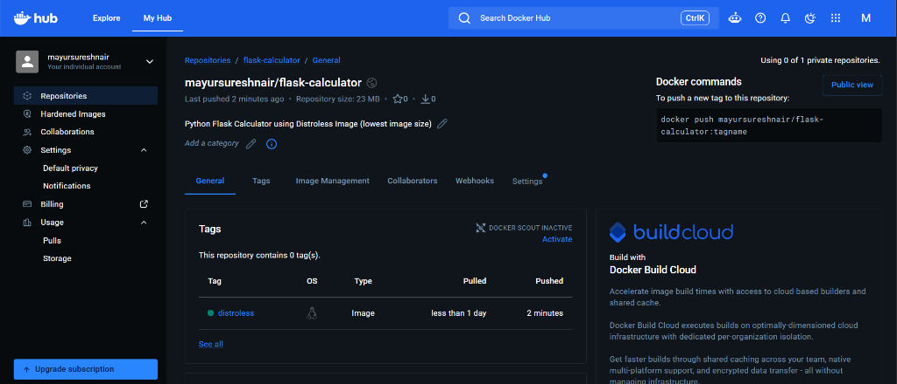
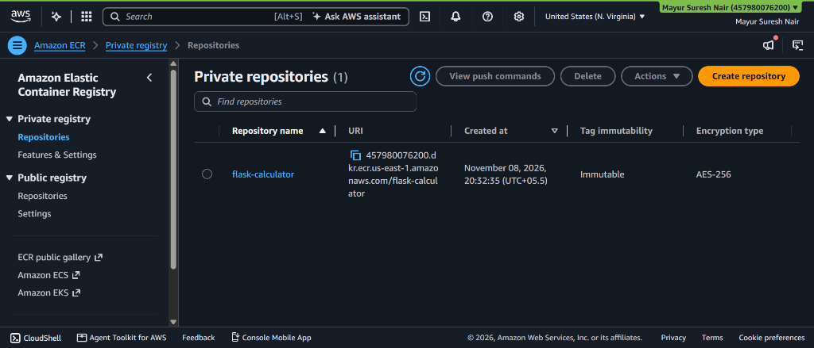
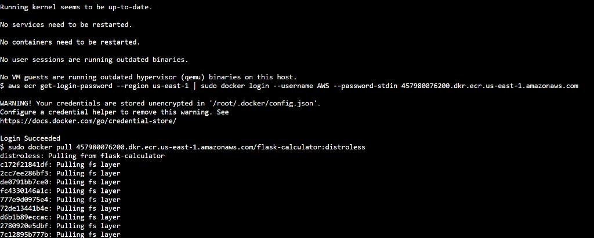
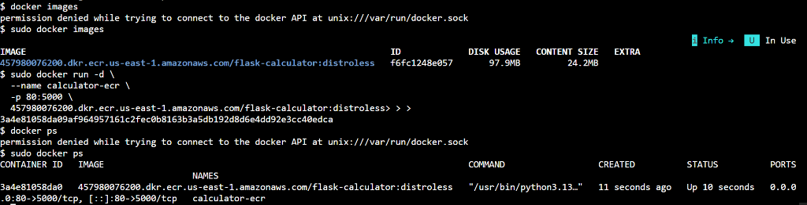
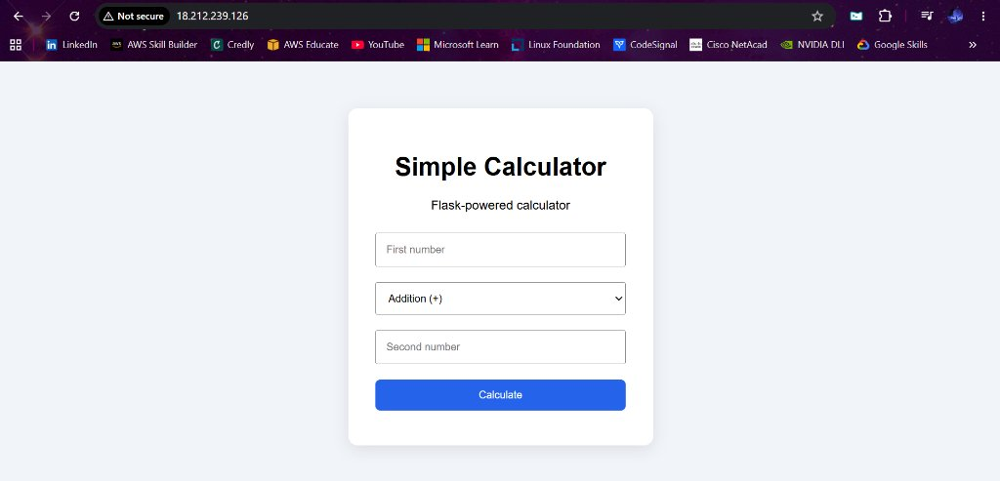

# 🐳 Docker Image Optimization & Deployment

### Multi-Stage and Distroless Builds with Docker Hub & Amazon ECR

Built and deployed a **Flask Calculator** application using Docker and AWS, exploring different containerization strategies to improve image efficiency and deployment.

---

## 📌 Highlights

- ✅ Created **Single-Stage**, **Multi-Stage**, and **Distroless** Docker images
- ✅ Achieved approximately **50% image size reduction** using Distroless compared to Single-Stage
- ✅ Published and pulled container images using **Docker Hub**
- ✅ Created a private **Amazon ECR** repository and pushed the optimized (Distroless) image
- ✅ Configured an **EC2 IAM role** for secure ECR access without storing long-lived AWS credentials
- ✅ Pulled and deployed the container on an **AWS EC2** instance
- ✅ Verified the application through its **public endpoint**

---

## 🏗️ Project Structure

```
multistage-docker/
├── .dockerignore
├── app.py                 # Flask calculator application
├── requirements.txt       # Python dependencies
├── Dockerfile             # Dockerfile (supports single/multi/distroless stages)
├── templates/
│   └── index.html         # Calculator UI
├── images/                # Screenshots & evidence
└── README.md
```

---

## 🔨 Building the Docker Images

### Single-Stage Build

```bash
docker build -t flask-calculator:single .
```



### Multi-Stage Build

```bash
docker build -t flask-calculator:multi .
```

### Distroless Build

```bash
docker build -t flask-calculator:distroless .
```

---

## 📊 Image Size Comparison

| Build Type   | Disk Usage | Image Size | Localhost
|:-------------|:-----------|:-----------|:-----------|
| **Single-Stage**  | 200.77 MB  | 49.0 MB  | 5000  |
| **Multi-Stage**   | 186.24 MB  | 45.3 MB  | 5001  |
| **Distroless**    | 97.86 MB   | 24.2 MB  | 5002  |

> 💡 The Distroless image is roughly **50% smaller** than the Single-Stage image !

> Note: This is a very basic application with minimal dependencies, which is why there isn't much to shrink the image size. As the application gets bigger and more complex, Docker can reduce the image size by up to 80% or even 90% for some Golang distroless images.

### Docker Desktop — Image List



### Terminal — `docker images` output



---

## 🧪 Local Testing

Ran the container locally and verified the Flask Calculator on `localhost:5002`:



---

## 📤 Publishing to Docker Hub

Pushed the **Distroless image** (lowest storage footprint) to Docker Hub:

```bash
docker login
docker tag flask-calculator:distroless mayursureshnair/flask-calculator:distroless
docker push mayursureshnair/flask-calculator:distroless
```



---

## ☁️ Publishing to Amazon ECR

Created a **private ECR repository** and pushed the Distroless image:

```bash
# Authenticate Docker to ECR
aws ecr get-login-password --region us-east-1 |
  docker login --username AWS --password-stdin <aws_account_id>.dkr.ecr.us-east-1.amazonaws.com

# Tag and push
docker tag flask-calculator:distroless \
  <aws_account_id>.dkr.ecr.us-east-1.amazonaws.com/flask-calculator:distroless

docker push <aws_account_id>.dkr.ecr.us-east-1.amazonaws.com/flask-calculator:distroless
```



---

## 🚀 Deploying on AWS EC2

### Steps

1. **Launched an EC2 instance** and attached an **IAM role** with `AmazonEC2ContainerRegistryReadOnly` permission for secure ECR access (no long-lived credentials).
2. **Installed Docker CLI and AWS CLI** on the EC2 instance.
3. **Authenticated to ECR** and **pulled the Distroless image**:

```bash
aws ecr get-login-password --region us-east-1 |
  sudo docker login --username AWS --password-stdin <aws_account_id>.dkr.ecr.us-east-1.amazonaws.com

sudo docker pull <aws_account_id>.dkr.ecr.us-east-1.amazonaws.com/flask-calculator:distroless
```



4. **Ran the container**, mapping port 80 → 5000:

```bash
sudo docker run -d \
  --name calculator-ecr \
  -p 80:5000 \
  <aws_account_id>.dkr.ecr.us-east-1.amazonaws.com/flask-calculator:distroless
```



5. **Verified the deployment** by visiting the EC2 public IP in the browser:



---

## 🛠️ Tech Stack

| Tool / Service | Purpose |
|:---------------|:--------|
| **Python + Flask** | Web application framework |
| **Docker** | Containerization |
| **Docker Hub** | Public container registry |
| **Amazon ECR** | Private container registry |
| **AWS EC2** | Cloud compute for deployment |
| **IAM Roles** | Secure, credential-less ECR access |

---

## 📝 Key Takeaways

- **Multi-Stage builds** strip out build-time dependencies, producing leaner images.
- **Distroless images** go further by removing the OS shell and package manager entirely — ideal for production.
- **IAM roles** on EC2 eliminate the need to manage AWS access keys manually.
- Choosing the right base image strategy can cut your container size (and attack surface) in half.

---

## 📄 License

This project is licensed under the **MIT License**.

---

*Happy containerizing! 🐳*
